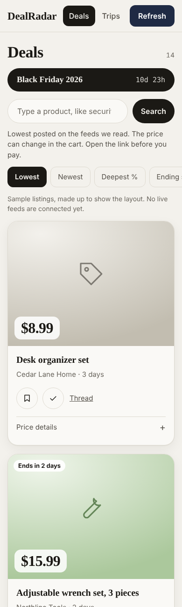

# DealRadar

A deal and trip price finder that never overstates what it knows. Every row is a lead, not a verified checkout price, and every card shows its source, posted date, and age.

Working name. Plans: [docs/SPEC-PUBLIC.md](docs/SPEC-PUBLIC.md).

## Status

The board runs on made-up sample data. Store search for eBay, Amazon, and Best Buy is built but has not been run against the real APIs yet.



## Run it

Needs Node 22.5 or newer. There are no packages to install.

```
npm start
```

Then open http://127.0.0.1:8080. The server listens on your own computer only unless you change `HOST`.

### Store search (eBay, Amazon, Best Buy)

Pressing Search asks each connected store's official search API and mixes the results with posted listings, lowest price first. A store without keys is skipped and shown as "not connected yet".

1. Copy `.env.example` to `.env` (same folder as `package.json`).
2. Fill in the keys for the stores you have. `.env` is ignored by git; never commit it.
3. Restart with `npm start`.

Best Buy is switched off in `config/sources.json` until its terms are checked. Rules each store sets, and what has not been tested against the real APIs yet: [docs/LIVE-SEARCH.md](docs/LIVE-SEARCH.md).

```
npm test
```

Tests run offline from the files in `fixtures/`.

## How it is built

| Folder | What it holds |
|---|---|
| `src/server.js` | Web server and JSON API |
| `src/ingest.js` | Cleans source records, merges the same offer from several sources, records failures |
| `src/present.js` | Trust labels, age, all-in cost, expiry, sort order |
| `src/adapters/` | One file per source: sample feeds, eBay, Amazon, Best Buy |
| `src/search.js` | Product search across posted listings and connected stores |
| `config/sources.json` | Sources and their on/off switches |
| `public/` | The board (plain HTML, CSS, and JavaScript) |
| `fixtures/` | Sample data |

## Rules

- Use only sources approved in the spec. No Reddit or Slickdeals data in this app.
- No scraping of store, resort, cruise-line, or rental pages.
- "Expected" is never shown as "Confirmed."
- Keep keys in `.env`, never in git. This repository is public.
- No new package or paid service without the owner's approval.
- Work on feature branches and open pull requests. Do not push to `main`.
