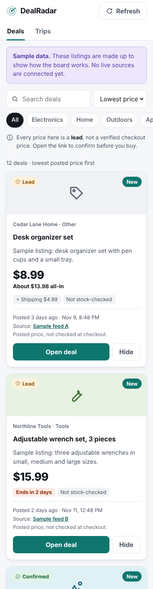

# DealRadar

A deal and trip price finder that never overstates what it knows. Every row is a lead, not a verified checkout price, and every card shows its source, posted date, and age.

Working name. Plans: [docs/SPEC-PUBLIC.md](docs/SPEC-PUBLIC.md).

## Status

Foundation only. The board runs on made-up sample data. No live sources are connected.



## Run it

Needs Node 22.5 or newer. There are no packages to install.

```
npm start
```

Then open http://127.0.0.1:8080. The server listens on your own computer only unless you change `HOST`.

```
npm test
```

Tests run offline from the files in `fixtures/`.

## How it is built

| Folder | What it holds |
|---|---|
| `src/server.js` | Web server and JSON API |
| `src/ingest.js` | Cleans source records, merges the same offer from several sources, records failures |
| `src/present.js` | Trust labels, age, all-in cost, expiry, sort order |
| `src/adapters/` | One file per source. Only the sample adapter exists. |
| `config/sources.json` | Sources and their on/off switches |
| `public/` | The board (plain HTML, CSS, and JavaScript) |
| `fixtures/` | Sample data |

## Rules

- Use only sources approved in the spec. No Reddit or Slickdeals data in this app.
- No scraping of store, resort, cruise-line, or rental pages.
- "Expected" is never shown as "Confirmed."
- Keep keys in `.env`, never in git. This repository is public.
- No new package or paid service without the owner's approval.
- Work on feature branches and open pull requests. Do not push to `main`.
